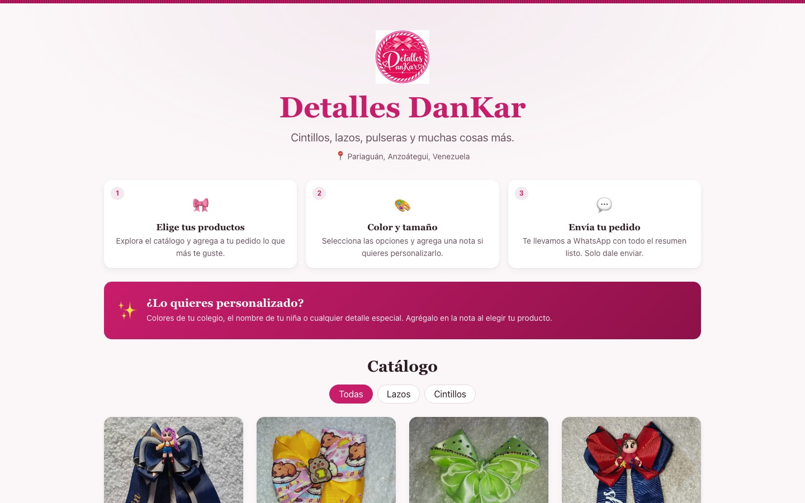

# Detalles DanKar

Online catalog for **Detalles DanKar**, a handmade hair-accessories shop in
Pariaguán, Venezuela. Customers browse the catalog, build an order and send it
straight to WhatsApp; the owner manages products, categories and photos from a
private admin panel.

Built for a **real client** and running in production.

**Live:** <https://dankar.vercel.app>

[](https://dankar.vercel.app)

## Features

- **Public catalog** with category filters
- **Order cart** — several products in a single WhatsApp message (saved in the browser)
- **Admin panel** protected with JWT in an httpOnly cookie
- **Category management** — create, rename, reorder and delete (moving their products)
- **Image uploads** to Cloudinary, validated by the file's real content, not just its name or MIME type
- **Persistent content** in MongoDB, validated with Zod

## Stack

| Layer | Tech |
| --- | --- |
| Frontend | React, React Router |
| Backend | Node.js, Express, Zod |
| Auth | JWT + bcrypt, httpOnly cookie |
| Data & media | MongoDB, Cloudinary |
| Deploy | Vercel (frontend) + Render (API) |

## How it fits together

- Vercel rewrites `/api/*` to the Render API, so the browser only ever talks to
  one origin and the session cookie stays first-party.
- Security headers (including a strict Content-Security-Policy) are set in
  `vercel.json`.
- Admin login attempts and image uploads are rate-limited per IP
  (`server/middleware/limitador.js`).

## Getting started

Requires Node.js, a MongoDB database and a Cloudinary account.

```bash
npm install
cp .env.example .env               # fill in MongoDB, JWT and Cloudinary values
node server/scripts/hash-password.js   # generates ADMIN_PASSWORD_HASH
npm run server                     # API on http://localhost:4000
npm start                          # React app on http://localhost:3000 (proxies /api)
```

See `.env.example` for every environment variable.

## Tests

```bash
CI=true npm test
```

## Author

Built by [Jesus Figueroa](https://jfigueroa.dev) · [GitHub](https://github.com/JKs162426)
